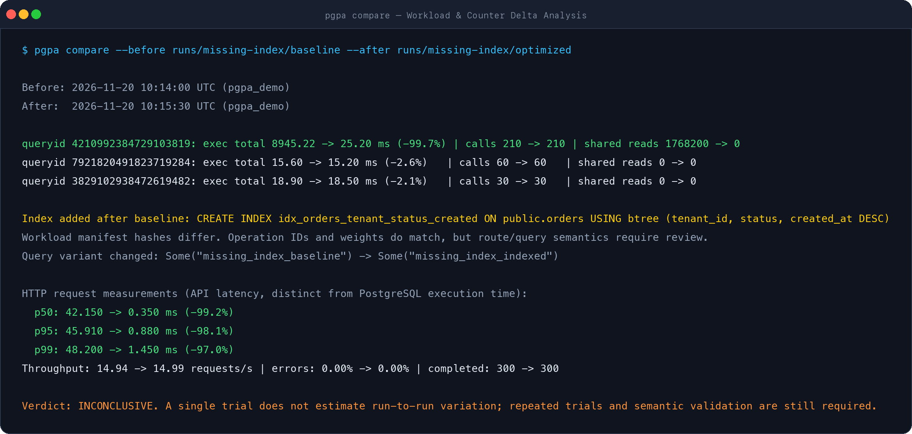
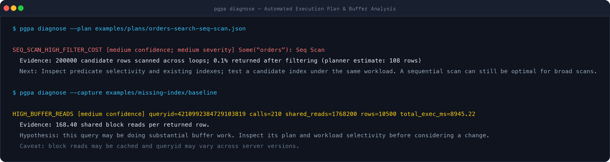
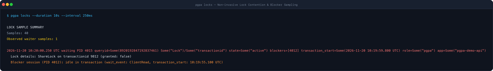
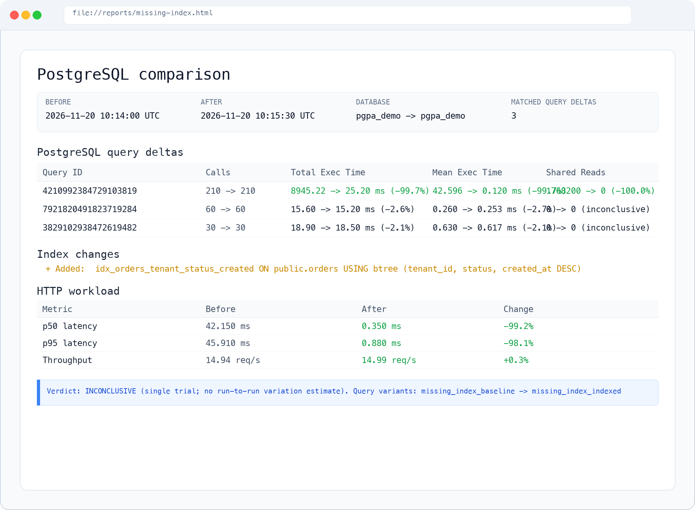
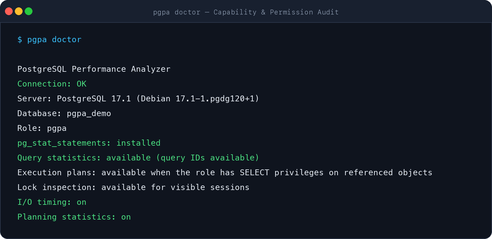

# PostgreSQL Performance Analyzer (`pgpa`)

Find expensive PostgreSQL queries, inspect execution plans and lock waits, and measure whether a workload change helped.

`pgpa` combines PostgreSQL's existing statistics with repeatable HTTP workloads and offline before/after artifacts. Findings are investigation leads; test proposed changes with representative data and repeated trials before drawing a performance conclusion.



## What it does

- **Doctor (`pgpa doctor`)**: Audits PostgreSQL capabilities, permissions, `pg_stat_statements`, I/O timing, and planner statistics.
- **Inspect (`pgpa inspect`)**: Ranks live `pg_stat_statements` queries by execution time, calls, shared buffer reads, or temporary blocks.
- **Capture (`pgpa capture`)**: Captures bounded query-counter deltas, table/index metadata, database settings, and counter-integrity issues.
- **Locks (`pgpa locks`)**: Samples lock waiters, blockers, `pg_locks`, and session metadata at bounded non-invasive intervals.
- **Explain (`pgpa explain`)**: Runs nonexecuting JSON EXPLAIN by default and recursively analyzes actual JSON plans.
- **Diagnose (`pgpa diagnose`)**: Automated heuristic diagnosis for high buffer reads, repeated calls, lock contention, sequential scan filter costs, row estimate mismatches, and disk spills.
- **Run (`pgpa run`)**: Executes deterministic, fixed-rate HTTP workloads from TOML manifests with bounded concurrency.
- **Compare (`pgpa compare`)**: Compares request latency distributions and PostgreSQL counters, validates workload comparability, and provides honest statistical verdicts.
- **Report (`pgpa report`)**: Writes offline terminal, JSON, Markdown, or standalone responsive HTML reports.

The workload engine bounds request rate, in-flight requests, duration, and total scheduled requests. POST workloads require `--allow-writes`. Captures and run summaries omit SQL unless explicitly requested; connection credentials are not written to artifacts.

---

## Showcase Gallery

| Feature                                                                                                                                                                 | Demonstration                                               |
| ----------------------------------------------------------------------------------------------------------------------------------------------------------------------- | ----------------------------------------------------------- |
| **Automated Plan & Buffer Diagnosis**<br>Detects filter-heavy sequential scans, row cardinality estimate mismatches, and buffer pressure.                               |   |
| **Lock Contention Sampling**<br>Samples active waiters and blocker relationships without blocking transactions or running long monitor loops.                           |                 |
| **Standalone HTML Comparison Report**<br>Self-contained HTML reports featuring matched query deltas, index diffs, and latency quantiles with zero runtime dependencies. |  |
| **Database Capability & Safety Audit**<br>Verifies PostgreSQL configuration, read permissions, extension availability, and timing flags.                                |      |

---

## Immediate Offline Verification

You can explore `pgpa`'s analysis, comparison, and reporting engines immediately without requiring a running PostgreSQL database:

```sh
# 1. Build release binary
cargo build --release

# 2. Diagnose an execution plan offline
./target/release/pgpa diagnose --plan examples/plans/orders-search-seq-scan.json

# 3. Compare benchmark runs (missing-index baseline vs. indexed)
./target/release/pgpa compare --before examples/missing-index/baseline --after examples/missing-index/optimized

# 4. Generate a standalone HTML report
./target/release/pgpa report --before examples/missing-index/baseline --after examples/missing-index/optimized --format html --output reports/missing-index.html

# 5. Generate Markdown or Terminal reports
./target/release/pgpa report --before examples/missing-index/baseline --after examples/missing-index/optimized --format markdown --output reports/missing-index.md
./target/release/pgpa report --before examples/missing-index/baseline --after examples/missing-index/optimized --format terminal --output -
```

---

## Quick start

Requirements: stable Rust and PostgreSQL 16–18. Query statistics need `pg_stat_statements`; `track_io_timing` and `track_planning` improve optional evidence.

```sh
cargo install --path .
export PGPA_DATABASE_URL='postgresql://localhost/mydb'
pgpa doctor                    # exit 0 = full, 2 = partial, 1 = connection/command failure
pgpa inspect --top 10 --sort total-time
pgpa capture --duration 30s --output runs/observe
pgpa diagnose --capture runs/observe
```

The database URL comes from `PGPA_DATABASE_URL` or `DATABASE_URL`. Keep credentials in a protected environment/configuration source. `doctor` does not install extensions or change settings. `pg_read_all_stats` may be needed to see other roles' query text/activity.

---

## Command Reference

```text
pgpa doctor
pgpa inspect [--top N] [--sort total-time|mean-time|max-time|calls|shared-reads|temp-blocks|rows]
             [--query-id ID] [--format table|json] [--include-sql] [--output FILE]
pgpa capture --duration 30s --output DIR [--include-sql]
pgpa locks --duration 15s --interval 250ms [--include-sql] [--output FILE]
pgpa explain --sql-file query.sql [--output FILE]
pgpa explain --sql-file query.sql --analyze --allow-execution [--allow-non-select]
pgpa diagnose [--capture DIR] [--plan FILE]
pgpa run --workload FILE.toml --label LABEL --output DIR [--allow-writes]
pgpa compare --before DIR --after DIR
pgpa report --before DIR --after DIR --format terminal|json|markdown|html --output FILE
```

### Command Behavior Notes

- `inspect` total time is cumulative PostgreSQL execution time, not wall-clock time.
- `capture` compares matching `(dbid, userid, queryid)` counters. New query entries and decreased/disappeared counters are recorded as capture limitations; window maximum latency is unavailable from cumulative statistics and is left null. Tables and indexes are ending snapshots.
- `locks` observations are samples at discrete timestamps, not a continuous wait history.
- `explain` without `--analyze` plans without executing the statement. `EXPLAIN ANALYZE` executes it and requires `--allow-execution`; statements that are not plainly SELECT-looking need the additional `--allow-non-select`. This conservative prefix check is not a SQL safety boundary. SELECT statements can call functions with side effects. Review the SQL and target before enabling execution.
- `diagnose` accepts `--capture DIR`, `--plan FILE`, or both. It parses both PostgreSQL's native `EXPLAIN (FORMAT JSON)` array output and normalized plan documents.
- `run` requires an HTTP manifest. The format and measurement limits are documented in [docs/benchmarking.md](docs/benchmarking.md). A run writes `summary.json` for HTTP measurements and environment fingerprints plus `investigation.json` for PostgreSQL counter deltas.
- `compare` checks comparability (database settings, PostgreSQL versions, workload definitions, arrival drift, minimum sample counts) and marks one-trial results inconclusive; it does not establish statistical significance or SQL result equivalence.
- `report` includes matched PostgreSQL query deltas, index additions/removals, HTTP latency distributions (p50, p95, p99), and throughput.

---

## Disposable Local Demonstration

The Compose demo binds PostgreSQL and the API to loopback, creates a dedicated non-superuser app/collector role, seeds deterministic multi-tenant data, and enables `pg_stat_statements`. It is isolated from arbitrary external databases.

```sh
make demo-up
make demo-doctor
make demo-baseline
make demo-plan-analyze       # explicitly executes the supplied demo SELECT
make demo-index
make demo-optimized
make demo-compare
make demo-report
```

Query rewrite and lock scenarios:

```sh
make demo-query-baseline     # runs a row-multiset equivalence check
make demo-query-optimized
cargo run -- compare --before runs/query-rewrite/baseline --after runs/query-rewrite/optimized
make demo-lock               # samples a deliberately long row-lock transaction
make demo-lock-optimized     # shortens the transaction and verifies final row state
```

The scenarios use real PostgreSQL and HTTP requests. `CREATE INDEX CONCURRENTLY` is confined to the disposable Compose database and is run outside a transaction. `make demo-down` removes the database volume and its data.

---

## Development and Testing

```sh
# Formatting check
cargo fmt --all --check

# Linter check
cargo clippy --workspace --all-targets -- -D warnings

# Run all unit tests
cargo test --workspace

# Build optimized release binaries
cargo build --workspace --release

# CLI help
cargo run -- --help
```

CI builds on Linux and macOS and runs real PostgreSQL integration tests against PostgreSQL 16, 17, and 18. The local integration test skips unless `PGPA_TEST_DATABASE_URL` points to a dedicated disposable test database.

---

## Limitations and Safety

- **Workload Scope:** The workload runner supports HTTP workloads against an API, not arbitrary direct SQL workloads.
- **Inconclusive Single Trials:** Single-run comparisons are always marked inconclusive. The tool does not automate multi-trial hypothesis testing or statistical significance calculations.
- **Attribution:** In shared environments, `pg_stat_statements` aggregates statements database-wide. Isolate the target database to attribute query counters accurately.
- **Safety First:** Diagnostics never install extensions, change server configuration, reset statistics, or execute query text automatically. Connections to remote non-loopback hosts require TLS.

See [docs/limitations.md](docs/limitations.md), [docs/safety.md](docs/safety.md), [docs/metrics.md](docs/metrics.md), and [docs/troubleshooting.md](docs/troubleshooting.md).

---


## License & Custom Work

[](mailto:work@withrana.com) [](https://www.linkedin.com/in/workwithrana)
[](https://www.upwork.com/freelancers/~01bbcf6edb91a8df5f)
[](https://contra.com/ranajahanzaib/)

**License:** MIT, see [LICENSE](LICENSE). Free for personal and commercial use.

**Author:** Rana Jahanzaib

**Need this built for your stack?** Email me what you're working on: work@withrana.com
